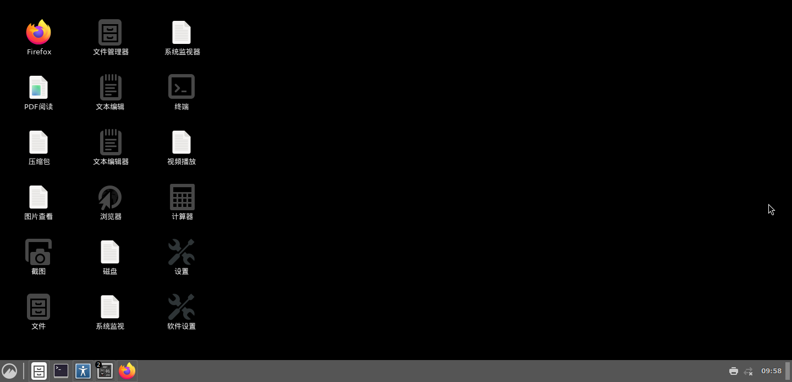
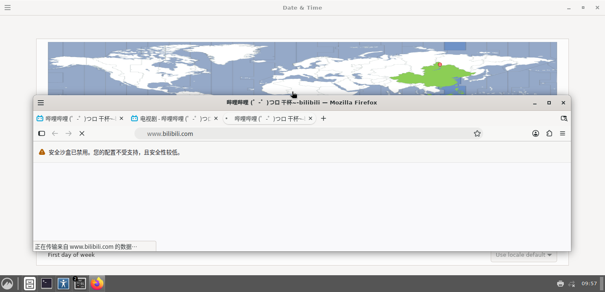

# 在 Android 上把 Wayland 跑起来：三个 LD_PRELOAD 劫持点

> **没 Root、没解锁 BL、没改内核、没刷 Magisk。**
> 一台普通国行红米，Android 15，`untrusted_app` 域，`CapEff: 0000000000000000`。
> Wayland 合成器跑起来了，28.8 fps。

这个仓库不讲怎么装 Ubuntu，只讲**一件卡死所有人的事**：

**SELinux 不让你创建文件 socket，而 Wayland 协议层写死了要用文件 socket。**

---

## 一、问题长什么样

你在 Android 非 root 环境里跑任何 Wayland 合成器（sway / weston / wlroots 全家桶），
第一条命令就会死在这里：

```
$ sway
[wl_display_add_socket] failed to bind socket: Permission denied
```

或者更隐晦一点：

```
$ XDG_RUNTIME_DIR=/tmp/xdg weston
fatal: environment variable XDG_RUNTIME_DIR is set to "/tmp/xdg", which is not a directory.
```

看起来像路径问题，其实是 **SELinux 在拦 `bind()`**。

### 为什么会被拦

Wayland 的 `wl_display_add_socket()` 干的事是：

```c
socket(AF_UNIX, SOCK_STREAM, 0)
bind(fd, "/run/user/1000/wayland-0", ...)   // ← 这里被拒
listen(fd, ...)
```

而 Android 的 SELinux 策略里，`untrusted_app` / `shell` 域**没有**对
`unix_stream_socket` 之外的 `sock_file` 的 `create` 权限。抽象命名空间（abstract namespace）
反而是放行的——因为抽象 socket 不落地成文件，没有 `sock_file` 标签。

### 实测三条路

| 尝试 | 结果 |
|---|---|
| `XDG_RUNTIME_DIR=/sdcard/...` | `/sdcard` 是 FUSE，不支持 socket → `EACCES` |
| `XDG_RUNTIME_DIR=/data/local/tmp` | SELinux 拒 `bind()` → `EACCES` |
| **改成抽象 socket** | ✅ 成功 |

---

## 二、解法：劫持 `bind()` / `connect()`

核心只有 30 行：

```c
static unsigned int fnv1a(const char *s) {
    unsigned int h = 2166136261u;
    while (*s) { h ^= (unsigned char)*s++; h *= 16777619u; }
    return h;
}

int bind(int fd, const struct sockaddr *addr, socklen_t len) {
    if (addr->sa_family == AF_UNIX) {
        const struct sockaddr_un *in = (const struct sockaddr_un *)addr;
        /* 文件路径 socket → 翻译成抽象 socket */
        if (in->sun_path[0] != '\0') {
            struct sockaddr_un out = {0};
            out.sun_family = AF_UNIX;
            snprintf(out.sun_path + 1, sizeof(out.sun_path) - 1,
                     "TLWL:%08x", fnv1a(in->sun_path));
            return real_bind(fd, (struct sockaddr *)&out, sizeof(out));
        }
    }
    return real_bind(fd, addr, len);
}
```

**关键点：`connect()` 必须用完全相同的哈希算法**，否则客户端连不上服务端。
这是唯一容易翻车的地方——两边算法差一个字节，你就是永远的 `ENOENT`。

### 三个劫持点

| 函数 | 原生行为 | 被拦原因 | 劫持后 |
|---|---|---|---|
| `bind()` | 落地成 `sock_file` | SELinux 拒 `create` | 抽象名 `@TLWL:<fnv1a8hex>` |
| `connect()` | 打开 `sock_file` | 同算法翻译 | 同上 |
| `shm_open()` | 用 `/dev/shm` | `/dev/shm` 不可写 | 改 `memfd_create` |

第三个同样重要：Wayland 的 `wl_shm` 全部依赖 `shm_open()`。
Android 没有可写的 `/dev/shm`，直接 `ENOENT`。

```c
int shm_open(const char *name, int oflag, mode_t mode) {
    int fd = real_shm_open(name, oflag, mode);
    if (fd >= 0) return fd;
    /* 退化到匿名共享内存，fd 语义完全一致 */
    return syscall(SYS_memfd_create, "tlshm",
                   (oflag & O_CLOEXEC) ? MFD_CLOEXEC : 0);
}
```

`memfd_create` 返回的 fd 和 `shm_open` 的 fd 在 `mmap` / `ftruncate` / 传递上**行为完全一致**。
Wayland 客户端根本不知道自己拿到的是 memfd。

---

## 三、编译和使用

```bash
gcc -O2 -fPIC -shared -o fakesock.so fakesock.c -ldl
```

```bash
LD_PRELOAD=/path/to/fakesock.so sway
```

**必须注意**：`LD_PRELOAD` 会污染 bionic 工具链。
你在 Android shell 里 `export LD_PRELOAD` 之后，`ls` / `sleep` / `head` 会全部报：

```
CANNOT link executable 'sleep': library "libc.so.6" not found
```

因为它们去找 glibc 了。**只在真正需要的那一条命令上挂 `LD_PRELOAD`**，
不要 export 到全局。

---

## 四、验证

抽象 socket 不会出现在文件系统里，要这样看：

```bash
grep "@" /proc/net/unix | sed 's/.*@/@/' | sort -u
```

成功时能看到：

```
@TLWL:dffa372e        ← 服务端 bind 出来的
@TLWL:ffc89242        ← 另一个 display
```

再加一个 `wl_display` 客户端验证：

```
Running compositor on wayland display 'wayland-1'
```

---

## 五、它解决到哪里为止

这个仓库只解决**「socket 建不起来」**。
后面还有两道墙，不在本仓库范围内：

| 墙 | 症状 | 在哪解决 |
|---|---|---|
| **渲染缓冲不匹配** | `renderer and allocator buffer capabilities don't match` | 需要改 wlroots 源码加 SHM 输出路径 |
| **DRM 节点打不开** | `/dev/dri/renderD128` → `EACCES` | 需要伪装 DRM 节点 / 走 surfaceless EGL |

第二道墙我这边已经打通了（`FAKESOCK_DRM=1` 那一坨），但涉及的东西比 socket 劫持复杂十倍，
整理完单独发。

---

## 六、这套东西适合谁

✅ **适合你，如果：**
- 想在 Android 上跑 Wayland 合成器
- 在写 Termux:X11 类似的替代品
- 遇到「明明有权限但 `bind` 就是 `EACCES`」
- 在 Android 上做容器 / 沙箱 / 图形栈移植

❌ **不适合你，如果：**
- 只是想在手机上跑个 Linux —— 用 Termux + proot-distro，一行命令
- 有 Root —— 直接 `supolicy` 加规则，不用劫持

---

## 七、实测环境

```
设备    Redmi 25053RT47C / onyx
SoC     骁龙 8s Gen 4 / Adreno 825
系统    Android 15 (SDK 35)，补丁 2025-10-01
内核    6.6.56-android15-8
身份    uid=2000(shell)  u:r:shell:s0  CapEff: 0000000000000000
合成器  sway 1.9 + wlroots 0.17.1（自编译，GLES2）
驱动    Mesa 27.0.0-devel / zink on Turnip / Vulkan 1.4
```

跑起来之后的样子（Cinnamon 桌面 + Firefox 加载 B 站）：





---

## 八、License

MIT。拿去用，不用问。

---

## 九、后续

这套东西是一整条链路上的一环。完整链路：

```
fakesock.so  ──→ Wayland socket 通
     ↓
wlroots 补丁 ──→ SHM 渲染通（28.8 fps）
     ↓
grabber      ──→ 抓帧 → Android SurfaceView
     ↓
Xwayland     ──→ 跑 X11 应用（Cinnamon / Firefox）
```

每一环都会单独发仓库。**Star 这个仓库，你就能收到后续更新。**
